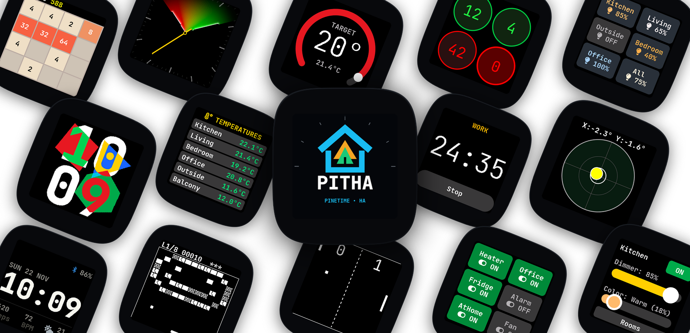

<div align="center">



<br>

[](https://github.com/renato-grottesi/pitha/releases)
[](LICENSE)
[](https://github.com/renato-grottesi/pitha/issues)
[](https://my.home-assistant.io/redirect/hacs_repository/?owner=renato-grottesi&repository=pitha&category=integration)

# PITHA — PineTime InfiniTime Home Assistant

*Custom firmware for the [PineTime smartwatch](https://pine64.org/devices/pinetime/) and companion Home Assistant BLE integration — **forked from [InfiniTime](https://github.com/InfiniTimeOrg/InfiniTime) v1.16.0**.*

</div>

> [!IMPORTANT]
> **Disclaimer — Personal Project:**
> This project is an independent personal project created and maintained by Renato Grottesi in his personal capacity and spare time. It is not an official product of, affiliated with, endorsed by, sponsored by, or otherwise associated with his employer or any other organization. All views, code, documentation, and opinions expressed in this repository are solely those of the author and do not represent the views or positions of his employer.
>
> **Warranty Disclaimer:** Per the [GNU General Public License v3](LICENSE), this software is provided *"as is"*, without warranty of any kind.

---

## About This Fork

**PITHA** (**P**ineTime **I**nfini**T**ime **H**ome **A**ssistant) extends [InfiniTime 1.16.0](https://github.com/InfiniTimeOrg/InfiniTime) with direct Bluetooth Low Energy (BLE) Home Assistant control, additional watch faces and utilities, accelerometer games, and responsiveness improvements:

- **Home Assistant BLE Integration (`custom_components/pinetime`)**: Direct watch-to-Home-Assistant control over BLE without an external ESP32 proxy — control **6 Light Dimmers** (on/off, brightness, color temperature), **6 Switches**, a circular **Thermostat** (target + current °C), a **6-row Temperature Monitor**, plus automatic BLE **Current Time Service** sync.
- **Quick Shortcuts & Usability**: Double-click the side button from anywhere to open Home Assistant; automatically returns to the watch face 1 minute after sleeping from inactivity.
- **New Watch Faces**: **Legend**, **Lights**, and **Polygons** (alongside InfiniTime **Digital**), with AOD-aware throttling.
- **New Utilities & Apps**: **Cooking Timer** (4 independent stove burners with haptic alerts), **Pomodoro** timer, **Bubble Level** (with tap-to-zero calibration), and organized launcher folders (**Time**, **Exercise**, **Games**, **Utilities**, **Home Assistant**).
- **Games & Persistence**: New accelerometer **Breakout** (8 pixel-art levels, 2-bit damage bricks) and accelerometer **AI Pong**, plus **in-RAM state persistence** for **2048**, **Breakout**, **Pong**, and **Dice**, and **non-disruptive chimes** that vibrate without closing your active app.
- **Performance & Reliability**: Partial VDB/dirty-rect redraw fixes, BLE sync deduplication, NimBLE `os_mbuf` leak fixes, BMA421 scaling/polling optimizations, and an optional Bluetooth device allow-list.

---

## Installing the Firmware (from GitHub Releases)

Pre-built MCUboot firmware packages are published on the [PITHA GitHub Releases](https://github.com/renato-grottesi/pitha/releases) page.

1. Download **`pinetime-mcuboot-app-dfu-<version>.zip`** from the latest release.
   *(If you use external flash fonts/images, also download `infinitime-resources-<version>.zip`.)*
2. *(Important if you already use Home Assistant with your watch)* Temporarily disable the `pinetime` integration in Home Assistant or step out of Bluetooth range of your Home Assistant host so your phone/PC can connect to the PineTime over BLE.
3. Flash the DFU zip using any InfiniTime companion app:
   - **Android ([Gadgetbridge](https://gadgetbridge.org/))**: Pair/connect your PineTime, open the firmware update action (`FW/App` installer), and select `pinetime-mcuboot-app-dfu-<version>.zip`.
   - **iOS ([InfiniLink](https://github.com/InfiniTimeOrg/InfiniLink))**: Connect to the watch, open **Software Update → Use Local File**, and pick the DFU `.zip`.
   - **Linux Desktop ([WatchMate](https://github.com/azymohliad/watchmate) / [Siglo](https://github.com/alexr4535/siglo) / [ITD](https://gitea.elara.ws/Elara6331/itd))**: Connect to the watch and upload the DFU `.zip` (for CLI with `itd` running: `itctl fw upgrade -a pinetime-mcuboot-app-dfu-<version>.zip`).
   - **Web Browser ([InfiniTimeExplorer](https://infinitimeexplorer.netlify.app))**: Using Chrome or Edge with Web BLE, connect and flash `pinetime-mcuboot-app-dfu-<version>.zip`.
4. After the watch reboots at 100%, **validate** the new firmware on the watch under **Settings → Firmware → Validate** (otherwise MCUboot rolls back to your previous firmware on the next reboot — you can also trigger rollback intentionally by holding the side button for ~10 seconds).

See [Updating the software](doc/gettingStarted/updating-software.md) and [About the firmware and bootloader](doc/gettingStarted/about-software.md) for more details.

---

## Installing the Home Assistant Integration

The Home Assistant integration lives in [`custom_components/pinetime/`](custom_components/pinetime) and exposes a GATT server interface documented in [homeassistant/README.md](homeassistant/README.md).

### Option 1: 1-Click Install via HACS (Recommended)

Prerequisites: [Home Assistant](https://www.home-assistant.io/) with [HACS](https://hacs.xyz/) and the built-in **Bluetooth** integration enabled.

1. Click the badge below to open `renato-grottesi/pitha` directly inside your Home Assistant HACS custom repositories dialog and click **Add → Download**:

   [](https://my.home-assistant.io/redirect/hacs_repository/?owner=renato-grottesi&repository=pitha&category=integration)

2. Restart Home Assistant.
3. Click below to add the integration (or configure the auto-discovered **InfiniTime** / **PineTime** Bluetooth device under **Settings → Devices & Services**):

   [](https://my.home-assistant.io/redirect/config_flow_start/?domain=pinetime)

### Option 2: Manual Install from GitHub Releases

1. Download **`pitha-homeassistant-<version>.zip`** from the [PITHA GitHub Releases](https://github.com/renato-grottesi/pitha/releases) page.
2. Extract it into your Home Assistant configuration directory (`/config/`), so that files land in `/config/custom_components/pinetime/`:
   ```bash
   unzip pitha-homeassistant-<version>.zip -d /config/
   ```
3. Restart Home Assistant, then add **PineTime Smartwatch** under **Settings → Devices & Services**.

Full setup, entity mapping, and BLE protocol details are in [homeassistant/README.md](homeassistant/README.md).

---

## Development & Building from Source

- [Getting started with InfiniTime](doc/gettingStarted/gettingStarted-1.0.md)
- [Build the project](doc/buildAndProgram.md)
- [Build the project with Docker](doc/buildWithDocker.md)
- [Build the project with VSCode](doc/buildWithVScode.md)
- [Flash the firmware using OpenOCD and STLinkV2](doc/openOCD.md) / [SWD](doc/SWD.md) / [JLink](doc/jlink.md) / [GDB](doc/gdb.md)
- [Bootloader, OTA and DFU](bootloader/README.md)
- [BLE implementation and API](doc/ble.md) & [Memory analysis](doc/MemoryAnalysis.md)
- [Rough structure of the code](doc/code/Intro.md) & [How to implement an application](doc/code/Apps.md)
- [How to contribute](CONTRIBUTING.md) & [Coding conventions](doc/coding-convention.md)

---

## License, Legal Notice & Credits

This project is forked from **[InfiniTime](https://github.com/InfiniTimeOrg/InfiniTime)** and released under the **GNU General Public License version 3 or, at your option, any later version** ([LICENSE](LICENSE)). Full attribution and a summary of fork modifications are provided in [NOTICE](NOTICE).

This repository represents the personal work of Renato Grottesi alone and is not affiliated with, endorsed by, or related to his employer in any way.

### Third-party libraries

- RTOS: **[FreeRTOS](https://freertos.org)** under the MIT license
- UI: **[LittleVGL/LVGL](https://lvgl.io/)** under the MIT license
- BLE stack: **[NimBLE](https://github.com/apache/mynewt-nimble)** under the Apache 2.0 license
- Font: **[JetBrains Mono](https://www.jetbrains.com/lp/mono/)** under the Apache 2.0 license

### Upstream InfiniTime Credits

PITHA is built upon the work of [JF002](https://github.com/JF002), the [InfiniTime contributors](https://github.com/InfiniTimeOrg/InfiniTime/graphs/contributors), and the `#pinetime` community:

- [Atc1441](https://github.com/atc1441/) — BMA421 motion sensor and I²C driver work
- [Koen](https://github.com/bosmoment) — NimBLE & LittleVGL integration assistance
- [Lup Yuen Lee](https://github.com/lupyuen) — MCUBoot bootloader, Flutter companion work, and PineTime documentation
